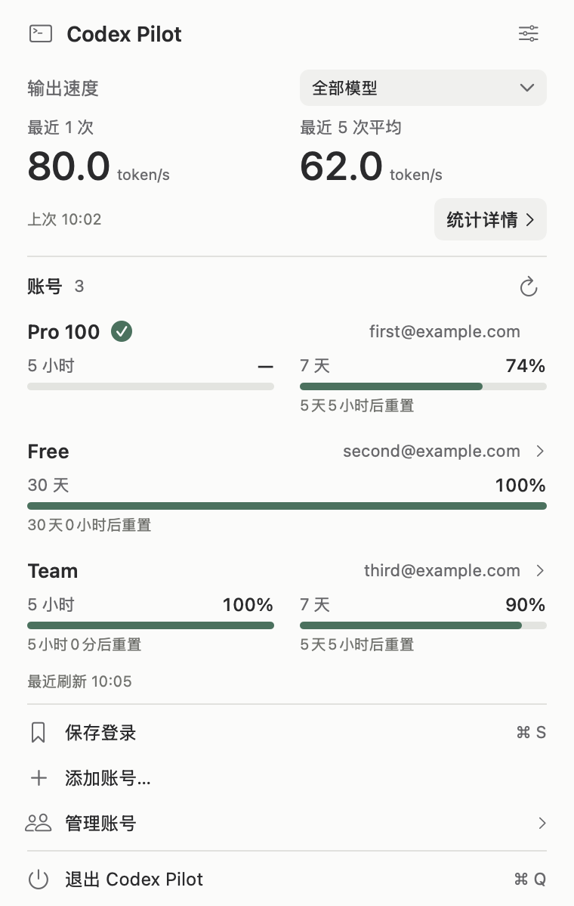
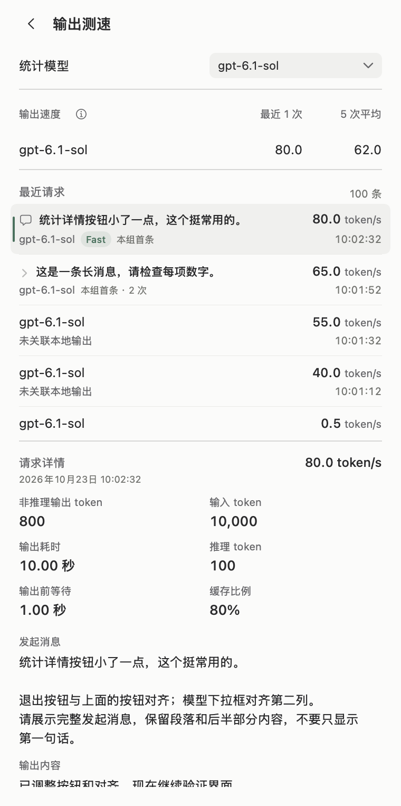

<h1 align="center">Codex Pilot</h1>

<p align="center">Codex output speed and account quotas, at a glance in your menu bar.</p>

<p align="center">
  <a href="https://github.com/skyqqcloud/codex-pilot/releases/latest"></a>
  <a href="https://github.com/skyqqcloud/codex-pilot/actions/workflows/macos.yml"></a>
  <a href="LICENSE"></a>
</p>

<p align="center">
  <a href="https://github.com/skyqqcloud/codex-pilot/releases/latest/download/Codex-Pilot-macOS-arm64.dmg"><strong>Download for macOS</strong></a> ·
  <a href="README.md">简体中文</a> ·
  <a href="docs/throughput.md">Measurement details</a> ·
  <a href="https://github.com/skyqqcloud/codex-pilot/issues">Report an issue</a>
</p>

Codex Pilot is a native macOS utility for **API output speed, account switching, and remaining quotas**. Built with SwiftUI and AppKit, it lives in the menu bar without a separate main window or Dock icon.

This is an independent community project, not affiliated with OpenAI.

The app supports English and Simplified Chinese and follows your macOS language. To choose a language for Codex Pilot, go to **System Settings → General → Language & Region → Applications**, then reopen the app.

<table>
  <tr><th>Accounts and output speed</th><th>Request groups and details</th></tr>
  <tr>
    <td valign="top"><a href="docs/images/main-light@2x.png"></a></td>
    <td valign="top"><a href="docs/images/request-detail-light@2x.png"></a></td>
  </tr>
</table>

## Features

| Feature | What it shows |
| --- | --- |
| **Two-line menu bar** | The selected model's latest TPS above the active account's remaining quota. Check both without opening the panel. |
| **Per-call measurements** | Latest-request and recent-five average rates, with up to 100 captured requests retained per model. |
| **Conversation groups** | Each initiating message appears once. Follow-up calls are collapsed by default; expand them for individual output or tool summaries, models, Fast labels, TPS, and usage. |
| **Multiple accounts** | Save, reorder, and switch logins. Refresh plans and quotas, with optional five-minute refreshes per account. |

File-change notifications, coalesced refreshes, incremental history reads, reusable workers, and separate background/interactive priorities reduce redundant work.

## Install

**Requires: Apple Silicon Mac · macOS 14+ · a signed-in Codex desktop client · Python 3.9+**

1. [Download the latest DMG](https://github.com/skyqqcloud/codex-pilot/releases/latest/download/Codex-Pilot-macOS-arm64.dmg) and drag **Codex Pilot** into Applications.
2. Open the app and find the two-arrow icon in your menu bar.
3. If macOS blocks the first launch, allow it in **System Settings → Privacy & Security**.

The release is currently Apple Silicon only, ad-hoc signed, and not Developer ID signed or notarized. Release notes and checksums are available in [Releases](https://github.com/skyqqcloud/codex-pilot/releases/latest).

<details>
<summary>Python requirements</summary>

Only the Python standard library is used; no extra Python packages are required. The app checks these executable locations in order:

```text
/opt/homebrew/bin/python3
/usr/local/bin/python3
/usr/bin/python3
```

The app uses the first executable found in that order; ensure it is Python 3.9 or newer. A Python installation provided by Homebrew or Command Line Tools can be used.

</details>

## First use

1. **Save your account:** sign in to Codex, open the Pilot panel, and choose **Save login**.
2. **Enable measurements:** in Settings, turn on **Local speed capture**, then **restart Codex**. Measurements appear after new API calls complete.
3. **Show menu bar values:** enable **Show TPS and quota** to replace the icon with two lines of values.

For another account, choose **Add account…**, follow the Codex sign-in flow, and save the new login. Reorder saved accounts under **Manage accounts**.

**Switching accounts quits and reopens Codex; finish your current work first.** Pilot requests a normal quit before replacing the login file. If quitting fails or is cancelled, it keeps the original login.

## How is TPS calculated?

TPS means tokens per second. Pilot measures the **client-observed non-reasoning output-stage rate**:

```text
TPS = (API output tokens - reasoning tokens) / non-reasoning output-stage duration
```

For example, 500 output tokens including 300 reasoning tokens, with a four-second output stage, gives `(500 - 300) / 4 = 50 token/s`.

Timing comes from Codex's official OpenTelemetry events and local output logs. It excludes waiting before output starts, idle time between requests, and local tool execution. The numerator may still include tool arguments and API formatting tokens. This is neither an exact visible-text rate nor a server-side GPU generation benchmark.

<details>
<summary>Averages, missing values, and Fast labels</summary>

- **Recent-five average:** take the five most recent captured completions for the selected model, then average the valid rates within that window. Missing values are not zero, and older requests do not fill the gaps.
- **Unknown values (`—`):** missing or ambiguous timing is never estimated. Requests made while capture was disabled cannot be reconstructed.
- **High rates on short outputs:** output arriving in a burst can produce a large ratio. Verifiable observations are kept without an artificial cap; they do not establish a sustained generation rate.
- **Output-stage boundaries:** later reasoning, buffering, or client delays may remain within the measured interval. A faster overall task does not necessarily have a proportionally higher TPS.
- **Fast labels:** shown only when telemetry explicitly reports `service_tier` as `fast` or `priority`. This identifies the requested mode, not a guarantee of the backend's final execution tier.

</details>

See [measurement definitions and data boundaries](docs/throughput.md) for the full timing, failure, and overlapping-request rules. Detailed technical and audit documents are currently in Chinese.

## FAQ

<details>
<summary>Which quota does the second menu bar line show?</summary>

It shows the active saved account's **remaining quota**. When several quota windows are known, it uses the lower remaining value. If only one is known, it uses that value. Missing quota data or an unsaved active account shows `—`; unknown values are never treated as `0%`.

</details>

<details>
<summary>Why are several API calls grouped under one user message?</summary>

Codex may output text or call tools, then request the model again during a single task. Pilot groups these calls under the initiating message, with a separate TPS for each call. The message row represents the earliest captured call still retained in that group, labelled **First retained**. Expanding reveals later calls without repeating the user message.

</details>

<details>
<summary>What does “No associated local output” mean?</summary>

API usage or timing was captured, but no output could be reliably matched in the local logs. This does not mean the conversation lacks a project or that the call failed. When evidence is missing, Pilot keeps the record without borrowing content from another request.

</details>

<details>
<summary>Do plan names update?</summary>

Yes. Quota refreshes also update the server-reported plan identifier. Explicit identifiers map to names: `prolite` → Pro 100, `pro` → Pro 200, and `promax` → Pro 500. Pilot does not infer plans from prices or quotas. Free accounts use the quota windows returned by the service.

</details>

## Data and privacy

- **Local storage:** `~/.codex-swap/` holds saved credentials, quota caches, and measurements. Saved logins contain full credentials protected by filesystem permissions, **not Keychain encryption**. The active Codex login is at `$CODEX_HOME/auth.json`, defaulting to `~/.codex/auth.json`.
- **Local capture:** the receiver binds only to `127.0.0.1:45417` and requires a random token. Enabling capture backs up the configuration and adds a marked `[otel]` block; existing custom telemetry settings are not overwritten.
- **Network access:** Pilot does not proxy model requests, issue extra speed-test calls, or upload conversations to the maintainer. Quota refreshes and credential renewal contact the relevant OpenAI endpoints.
- **Message matching:** local caches may contain conversation identifiers and bounded message previews. Full messages, output, and tool content are read from local Codex records when displayed. Do not publish credentials, caches, raw logs, or unredacted screenshots.

Quota endpoints, plan fields, and local log formats depend on the upstream client and may change. Report vulnerabilities privately using the instructions in [SECURITY.md](SECURITY.md).

## Build from source

Requires macOS, Python 3.9+, and a Swift compiler with a macOS SDK from Xcode or Command Line Tools.

```bash
git clone https://github.com/skyqqcloud/codex-pilot.git
cd codex-pilot
bash scripts/check.sh
bash scripts/build-dmg.sh
```

Outputs: `dist/Codex Pilot.app` and `dist/Codex Pilot.dmg`. Default checks use synthetic data without calling a real model or modifying your login.

<details>
<summary>SDK selection, native checks, and source map</summary>

Set `CODEX_PILOT_SDK` to select an SDK. Otherwise, the scripts prefer an installed macOS 26 SDK and fall back to `xcrun --show-sdk-path`. If Command Line Tools lacks the SDK's SwiftUI macro plugins, use a compatible SDK or a full Xcode toolchain.

```bash
bash scripts/check-scroll-layout.sh  # Native offscreen UI, grouping, account switching, and QoS
bash scripts/check.sh --live         # Additional read-only local-record checks; never run in CI
```

Native checks require an available macOS WindowServer. `Package.swift` defines the telemetry module and XCTest checks, not the complete app; use the packaging script for the app.

| Directory | Responsibility |
| --- | --- |
| `app/` | SwiftUI / AppKit views, state, menu bar, and task scheduling |
| `app/Telemetry/` | Log parsing, sample validation, and TPS statistics |
| `backend/` | Python account management, local capture, and history matching |
| `tests/` | Synthetic regression, timing validation, and native UI checks |
| `docs/` | Measurement definitions, historical audits, and demo screenshots |
| `ThirdParty/` | Upstream licenses and modification notices |

</details>

[Issues](https://github.com/skyqqcloud/codex-pilot/issues) and pull requests are welcome. See [CONTRIBUTING.md](CONTRIBUTING.md) for development and regression requirements.

Technical notes: [TPS accuracy](docs/tps-accuracy-audit-20261011.md) · [Resident energy use](docs/energy-audit-20261016.md) · [History read optimizations](docs/energy-audit-20261018.md) · [Plan mapping](docs/plan-names-20261019.md).

## License and acknowledgements

Licensed under [Apache License 2.0](LICENSE). Some telemetry parsing code derives from [OPL Fleet Agent](https://github.com/gaofeng21cn/opl-fleet-agent), with attribution, the [upstream license](ThirdParty/OPLFleetAgent/LICENSE), and [modification notices](ThirdParty/OPLFleetAgent/NOTICE) preserved. See [NOTICE](NOTICE).
