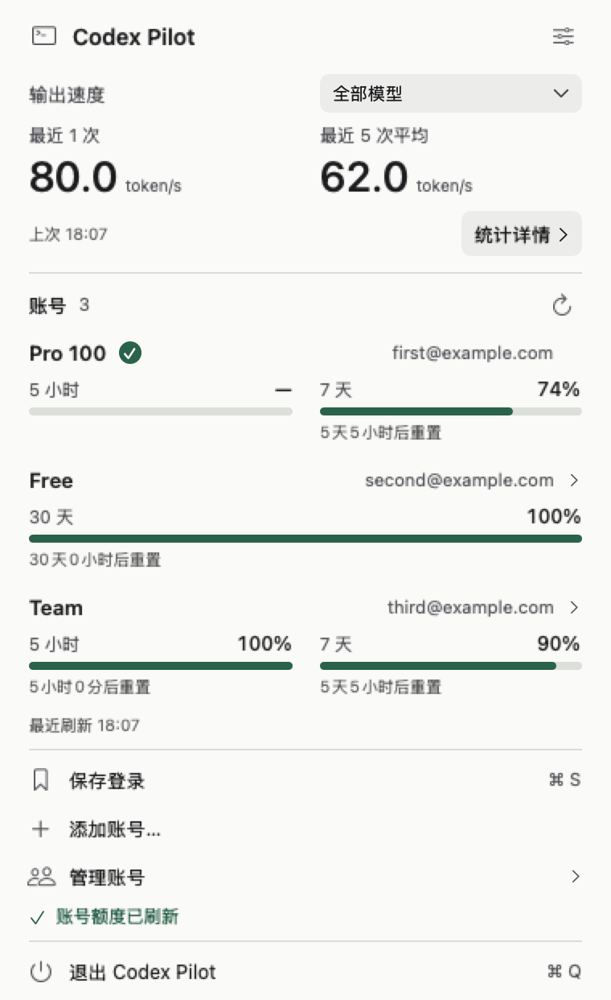
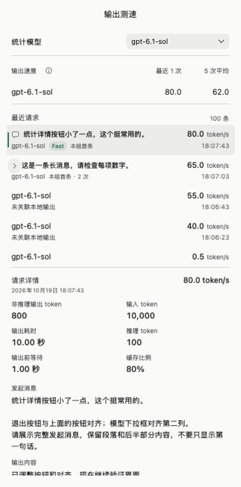

<h1 align="center">Codex Pilot</h1>

<p align="center">在菜单栏，看清 Codex 的输出速度与账号额度。</p>

<p align="center">
  <a href="https://github.com/skyqqcloud/codex-pilot/releases/latest"></a>
  <a href="https://github.com/skyqqcloud/codex-pilot/actions/workflows/macos.yml"></a>
  <a href="LICENSE"></a>
</p>

<p align="center">
  <a href="https://github.com/skyqqcloud/codex-pilot/releases/latest/download/Codex-Pilot-macOS-arm64.dmg"><strong>下载 macOS 版</strong></a> ·
  <a href="README.en.md">English</a> ·
  <a href="docs/throughput.md">统计口径</a> ·
  <a href="https://github.com/skyqqcloud/codex-pilot/issues">反馈问题</a>
</p>

Codex Pilot 是一个原生 macOS 菜单栏工具，集 **API 输出测速、多账号切换、剩余额度查看** 于一处。使用 SwiftUI / AppKit 构建，常驻菜单栏，没有独立主窗口或 Dock 图标。

这是独立的社区项目，与 OpenAI 无隶属关系。

<table>
  <tr><th>账号与输出速度</th><th>请求分组与详情</th></tr>
  <tr>
    <td valign="top"></td>
    <td valign="top"></td>
  </tr>
</table>

*截图来自原生离屏测试，账号、消息和测速样本均为演示数据。截图中的数值不代表实际性能。*

## 功能一览

| 功能 | 你能看到什么 |
| --- | --- |
| **双行菜单栏** | 上排显示所选模型最近一次 TPS，下排显示当前激活账号的剩余额度。无需打开面板即可查看。 |
| **逐次 API 测速** | 同时查看最近一次和最近 5 次平均速度；每个模型保留最近 100 条已采集请求。 |
| **对话分组与详情** | 发起消息只显示一次，后续调用默认折叠。展开可查看每次调用的输出或工具摘要、模型、Fast 标记、TPS 和用量。 |
| **多账号与额度** | 保存、排序、切换登录；刷新套餐与额度周期，可按账号开启每 5 分钟自动刷新。 |

后台采用文件变化通知、合并刷新和增量历史读取，复用读取进程，并区分后台与交互任务的调度优先级，减少重复工作。

## 安装

**需要：Apple Silicon Mac · macOS 14+ · 已登录的 Codex 桌面客户端 · Python 3.9+**

1. [下载最新 DMG](https://github.com/skyqqcloud/codex-pilot/releases/latest/download/Codex-Pilot-macOS-arm64.dmg)，将 **Codex Pilot** 拖入“应用程序”。
2. 打开应用，在菜单栏找到双向箭头图标。
3. 如果 macOS 阻止首次打开，请在“系统设置 → 隐私与安全性”中允许打开。

当前发布包仅支持 Apple Silicon，使用 ad-hoc 签名，尚未进行 Apple Developer ID 签名与公证。版本说明和校验文件见 [Releases](https://github.com/skyqqcloud/codex-pilot/releases/latest)。

<details>
<summary>Python 环境要求</summary>

运行时仅使用 Python 标准库，不需要安装额外 Python 包。应用依次查找以下可执行文件：

```text
/opt/homebrew/bin/python3
/usr/local/bin/python3
/usr/bin/python3
```

应用使用按上述顺序找到的第一个可执行文件，请确保该 Python 为 3.9 或更高版本。Homebrew 或 Command Line Tools 提供的 Python 可用于运行。

</details>

## 第一次使用

1. **保存当前账号**：确认已登录 Codex，打开 Pilot 面板，点击“保存登录”。
2. **开启测速**：进入设置，启用“本机测速采集”，然后**重启 Codex**。完成新的 API 调用后，面板会出现测速记录。
3. **开启菜单栏数值**：在设置中启用“状态栏显示 TPS 和额度”，将图标切换为双行数值。

需要多个账号时，点击“添加账号”，按提示完成另一个账号的 Codex 登录并保存。可在“管理账号”中调整顺序。

**切换账号会退出并重新打开 Codex，请先结束当前工作。** Pilot 会先请求 Codex 正常退出，成功后才替换登录文件；退出失败或取消时保留原登录。

## TPS 是怎么算的？

TPS 表示每秒输出的 token 数。这里统计的是**客户端观测到的非推理输出阶段速率**：

```text
单次 TPS =（API 总输出 token − 推理 token）÷ 非推理输出阶段耗时
```

例如，一次调用报告 500 个输出 token，其中 300 个是推理 token，对应输出阶段耗时 4 秒，则本次 TPS 为 `(500 − 300) ÷ 4 = 50 token/s`。

计时来自 Codex 官方 OpenTelemetry 事件和本地输出日志，排除首个输出前的等待、请求间空闲及本地工具执行。分子仍可能包含工具参数和 API 格式 token；这项指标不等于可见正文的精确速度，也不是模型内部 GPU 的纯生成速度。

<details>
<summary>平均值、缺失值和 Fast 标记的含义</summary>

- **最近 5 次平均**：先按所选模型取最近 5 条已采集完成记录，再对其中可测速的记录取算术平均。缺失值不当作 0，也不用第 6 条补位。
- **显示 `—`**：缺少可靠计时或无法确认配对关系时，不估算 TPS。未开启采集期间的历史请求也无法补算。
- **短输出的高 TPS**：少量输出集中到达时，比值可能很高。保留可核实的观测值，不设置人为上限；它不代表持续生成速度。
- **输出阶段的边界**：输出开始后的推理、缓冲或客户端延迟仍可能计入耗时。因此，完成整轮任务更快，不一定意味着这里的 TPS 同比例提高。
- **Fast 标签**：仅在遥测明确标记 `service_tier` 为 `fast` 或 `priority` 时显示，表示请求选择了 Fast 模式，不保证服务端最终执行档位。

</details>

完整的分子、分母、失败与重叠请求处理规则，见 [统计口径与数据边界](docs/throughput.md)。

## 常见问题

<details>
<summary>菜单栏第二排的百分比，显示哪段额度？</summary>

显示当前激活且已保存账号的**剩余额度**。有多个额度周期时，取已知剩余值中较低的一个；只有一个周期有数据时显示那个值。没有可靠额度或未保存当前账号时显示 `—`，不会把未知值当作 `0%`。

</details>

<details>
<summary>为什么一条用户消息下面会有多次 API 调用？</summary>

一次任务中，Codex 可能先输出内容或调用工具，再继续请求模型。Pilot 将这些调用归到同一条发起消息下，每次调用仍有自己的 TPS。消息行承载本组最早保留的一条已采集记录，标注“本组首条”；展开后显示后续调用，不重复展示同一条用户消息。

</details>

<details>
<summary>“未关联本地输出”是什么意思？</summary>

表示已采集到 API 用量或计时，但没有在本地日志中找到能可靠对应的输出。它不表示对话没有绑定项目，也不等于调用失败。缺少证据时，Pilot 保留记录，不把其他请求的内容补进来。

</details>

<details>
<summary>套餐名称会更新吗？</summary>

会。刷新额度时也会同步服务端套餐标识。当前按明确标识展示：`prolite` → Pro 100、`pro` → Pro 200、`promax` → Pro 500；不会根据额度或价格猜测套餐。Free 账号按接口返回的实际周期展示。

</details>

## 数据与隐私

- **本地存储**：`~/.codex-swap/` 保存账号凭据、额度缓存和测速样本。登录文件含完整凭据，使用文件权限保护，**不是钥匙串加密存储**。当前 Codex 登录位于 `$CODEX_HOME/auth.json`，默认是 `~/.codex/auth.json`。
- **本机采集**：接收器仅监听 `127.0.0.1:45417`，要求随机令牌。启用时先备份配置，再添加带标记的 `[otel]` 配置；已有自定义遥测配置时拒绝覆盖。
- **网络访问**：不代理模型 API，不发起额外测速调用，不向维护者上传对话。额度刷新与登录续期会访问相应的 OpenAI 接口。
- **消息关联**：本地缓存可能含会话标识和有限消息摘要。完整消息、输出与工具内容在展示时从本地 Codex 记录读取。不要公开上传凭据、缓存、原始日志或未脱敏截图。

额度接口、套餐字段和本地日志格式依赖上游客户端，可能随版本变化。安全问题请通过 [安全说明](SECURITY.md) 中的私密入口报告。

## 从源码构建

需要 macOS、Python 3.9+，以及 Xcode 或 Command Line Tools 提供的 Swift 编译器和 macOS SDK。

```bash
git clone https://github.com/skyqqcloud/codex-pilot.git
cd codex-pilot
bash scripts/check.sh
bash scripts/build-dmg.sh
```

产物：`dist/Codex Pilot.app` 和 `dist/Codex Pilot.dmg`。默认检查使用合成数据，不调用真实模型或修改实际登录。

<details>
<summary>SDK 选择、界面检查与代码导览</summary>

构建脚本支持通过 `CODEX_PILOT_SDK` 指定 SDK 路径。未指定时优先使用本机已有的 macOS 26 SDK，否则使用 `xcrun --show-sdk-path`。若 Command Line Tools 缺少对应 SDK 的 SwiftUI 宏插件，请使用完整 Xcode 工具链或兼容的 SDK。

```bash
bash scripts/check-scroll-layout.sh  # 原生离屏界面、分组、账号切换与 QoS 检查
bash scripts/check.sh --live         # 额外只读检查本机记录；不要在 CI 中使用
```

原生界面检查需要可用的 macOS WindowServer。`Package.swift` 仅定义遥测模块和 XCTest；完整 App 请使用打包脚本。

| 目录 | 职责 |
| --- | --- |
| `app/` | SwiftUI / AppKit 界面、状态管理、菜单栏和任务调度 |
| `app/Telemetry/` | 日志解析、样本校验和 TPS 统计 |
| `backend/` | Python 账号管理、本机采集、请求与历史关联 |
| `tests/` | 合成数据回归、计时验证和原生界面检查 |
| `docs/` | 统计定义、历史审计报告和演示截图 |
| `ThirdParty/` | 上游许可证与修改声明 |

</details>

欢迎提交 [Issue](https://github.com/skyqqcloud/codex-pilot/issues) 或 Pull Request。开发与回归要求见 [贡献指南](CONTRIBUTING.md)。

历史审计：[TPS 准确性](docs/tps-accuracy-audit-20261011.md) · [常驻能耗](docs/energy-audit-20261016.md) · [历史读取优化](docs/energy-audit-20261018.md) · [套餐映射](docs/plan-names-20261019.md)。这些报告记录特定版本与环境的结果，不代表长期节电承诺或真实系统菜单栏验收；个人原始数据和本机备份不随仓库发布。

## 许可证与致谢

项目采用 [Apache License 2.0](LICENSE)。部分遥测解析代码源自 [OPL Fleet Agent](https://github.com/gaofeng21cn/opl-fleet-agent)，已保留源文件署名、[上游许可证](ThirdParty/OPLFleetAgent/LICENSE) 和 [修改声明](ThirdParty/OPLFleetAgent/NOTICE)。详见 [NOTICE](NOTICE)。
